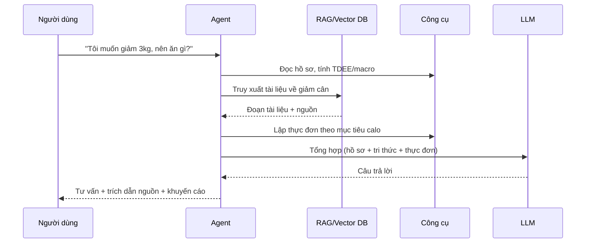

# Khảo sát, phân tích chức năng và thiết kế ứng dụng tư vấn thể dục và dinh dưỡng

## 1. Khảo sát các ứng dụng tương tự

### 1.1. Bảng so sánh

| Ứng dụng | Chức năng nổi bật | Ưu điểm | Hạn chế |
| --- | --- | --- | --- |
| MyFitnessPal | Nhật ký ăn uống, đếm calo, quét mã vạch, cơ sở dữ liệu thực phẩm lớn | Dữ liệu phong phú, cộng đồng đông | Ít món Việt, nhiều tính năng cần trả phí, không tư vấn hội thoại cá nhân hóa |
| Lose It! | Theo dõi calo, đặt mục tiêu cân nặng | Giao diện đơn giản | Tư vấn mang tính quy tắc cố định |
| Cronometer | Theo dõi chi tiết vi chất (vitamin, khoáng) | Dữ liệu dinh dưỡng chính xác | Phức tạp với người mới, ít tư vấn bằng ngôn ngữ tự nhiên |
| Yazio / Fitia | Gợi ý thực đơn, kế hoạch bữa ăn | Có thực đơn mẫu | Thực đơn ít sát khẩu vị và nguyên liệu Việt Nam |
| Nike Training Club / Fitbod | Gợi ý bài tập, lịch tập | Bài tập đa dạng, có video | Thiên về luyện tập, thiếu phần dinh dưỡng |
| Noom | Huấn luyện thay đổi hành vi | Có yếu tố tâm lý | Chi phí cao, tập trung thị trường nước ngoài |
| Chatbot LLM tổng quát (ChatGPT, Gemini, ...) | Hỏi đáp tự do | Linh hoạt, hiểu ngôn ngữ tự nhiên | Không lưu hồ sơ sức khỏe, không có nguồn trích dẫn đáng tin, dễ trả lời sai (hallucination) |

> Lưu ý: bạn nên tự cài và dùng thử từng ứng dụng, chụp màn hình, rồi chỉnh lại bảng theo trải nghiệm thật và phiên bản mới nhất. Nội dung trên là điểm khởi đầu.

### 1.2. Nhận xét và khoảng trống

1. Ứng dụng theo dõi calo mạnh về ghi chép nhưng yếu về tư vấn hội thoại.
2. Chatbot LLM mạnh về hội thoại nhưng thiếu dữ liệu cá nhân và nguồn tham chiếu đáng tin cậy.
3. Dữ liệu món ăn Việt Nam (phở, bún, cơm tấm, ...) còn thiếu trong các ứng dụng quốc tế.
4. Ít ứng dụng kết hợp **cả dinh dưỡng và thể dục** trong một tư vấn thống nhất.

**Hướng giải quyết của đề tài:** xây dựng ứng dụng dùng AI agent kết hợp RAG, truy xuất từ kho tri thức dinh dưỡng và thể thao đã chọn lọc, đồng thời gọi công cụ tính toán (BMI, BMR, TDEE) và đọc hồ sơ người dùng để đưa ra tư vấn cá nhân hóa, có trích dẫn nguồn.

### 1.3. Khảo sát nhu cầu người dùng (đề xuất)

Tạo biểu mẫu (Google Forms) với khoảng 10–12 câu, thu thập ít nhất 30–50 phản hồi:

- Nhóm tuổi, nghề nghiệp, mục tiêu (giảm cân, tăng cơ, duy trì sức khỏe).
- Đang dùng ứng dụng nào, khó khăn gặp phải.
- Mức độ quan tâm tới từng chức năng (thang 1–5): tính calo, gợi ý thực đơn, lịch tập, hỏi đáp, nhắc nhở.
- Mức sẵn sàng nhập dữ liệu hằng ngày.
- Mối lo ngại về độ tin cậy của tư vấn do AI đưa ra.

Kết quả khảo sát dùng làm căn cứ ưu tiên các chức năng ở mục 2.

---

## 2. Phân tích chức năng

### 2.1. Tác nhân (Actor)

| Tác nhân | Mô tả |
| --- | --- |
| Người dùng | Người cần tư vấn dinh dưỡng và luyện tập |
| Quản trị viên | Quản lý tài liệu tri thức, dữ liệu món ăn, bài tập, theo dõi hệ thống |
| Hệ thống AI agent | Tác nhân nội bộ: suy luận, gọi công cụ, truy xuất tri thức |

### 2.2. Yêu cầu chức năng

**Nhóm A – Tài khoản và hồ sơ (ưu tiên cao)**

- FR1: Đăng ký, đăng nhập, đăng xuất.
- FR2: Nhập và cập nhật hồ sơ: tuổi, giới tính, chiều cao, cân nặng, mức vận động, mục tiêu, dị ứng/món không ăn, thiết bị tập có sẵn.
- FR3: Tự động tính BMI, BMR, TDEE, nhu cầu protein/carb/fat theo mục tiêu.

**Nhóm B – Tư vấn bằng hội thoại (cốt lõi)**

- FR4: Chat hỏi đáp về dinh dưỡng và thể dục bằng tiếng Việt.
- FR5: Câu trả lời dựa trên kho tri thức (RAG) và hiển thị nguồn trích dẫn.
- FR6: Ghi nhớ ngữ cảnh hội thoại và hồ sơ người dùng.
- FR7: Từ chối hoặc khuyến cáo gặp bác sĩ với câu hỏi y khoa vượt phạm vi (bệnh lý, thuốc, triệu chứng nghiêm trọng).

**Nhóm C – Dinh dưỡng**

- FR8: Tra cứu thông tin dinh dưỡng của món ăn/thực phẩm (ưu tiên món Việt).
- FR9: Ghi nhật ký bữa ăn bằng văn bản (ví dụ "sáng nay ăn 1 tô phở bò") và hệ thống ước lượng calo, macro.
- FR10: Gợi ý thực đơn ngày/tuần theo mục tiêu, ngân sách, khẩu vị, loại trừ dị ứng.
- FR11: Thay thế món ăn tương đương dinh dưỡng.

**Nhóm D – Thể dục**

- FR12: Gợi ý lịch tập theo mục tiêu, trình độ, thời gian, dụng cụ.
- FR13: Hướng dẫn bài tập (nhóm cơ, số hiệp/lần, lưu ý an toàn).
- FR14: Ghi nhật ký buổi tập.

**Nhóm E – Theo dõi tiến độ**

- FR15: Ghi cân nặng/số đo định kỳ.
- FR16: Biểu đồ calo, macro, cân nặng, khối lượng tập theo thời gian.
- FR17: Báo cáo tuần và điều chỉnh kế hoạch dựa trên tiến độ thực tế.

**Nhóm F – Quản trị**

- FR18: Tải lên, cập nhật, xóa tài liệu tri thức; kích hoạt lập chỉ mục lại vector database.
- FR19: Quản lý cơ sở dữ liệu món ăn và bài tập.
- FR20: Xem nhật ký hội thoại ẩn danh để đánh giá chất lượng.

### 2.3. Yêu cầu phi chức năng

| Tiêu chí | Yêu cầu |
| --- | --- |
| Độ chính xác | Câu trả lời có căn cứ từ tài liệu, trích dẫn nguồn; hạn chế hallucination |
| An toàn | Có cảnh báo miễn trừ trách nhiệm, lọc câu hỏi y khoa, không khuyến nghị chế độ cực đoan (ví dụ calo quá thấp) |
| Hiệu năng | Phản hồi chat dưới khoảng 5–10 giây, hỗ trợ streaming |
| Bảo mật | Mã hóa mật khẩu, HTTPS, phân quyền, bảo vệ dữ liệu sức khỏe cá nhân |
| Khả dụng | Giao diện tiếng Việt, dùng được trên di động |
| Mở rộng | Tách module để thay đổi mô hình LLM hoặc thêm công cụ dễ dàng |

### 2.4. Biểu đồ use case (dạng văn bản)

```
Người dùng ── Quản lý hồ sơ ── Tính BMI/BMR/TDEE
          ├─ Chat tư vấn ───── Truy xuất tri thức (RAG)
          ├─ Ghi nhật ký ăn uống / tập luyện
          ├─ Nhận thực đơn / lịch tập
          └─ Xem tiến độ & báo cáo
Quản trị viên ── Quản lý tài liệu tri thức ── Cập nhật vector DB
             ├─ Quản lý dữ liệu món ăn / bài tập
             └─ Giám sát chất lượng hội thoại
```

### 2.5. Một số user story tiêu biểu

- Là người muốn giảm cân, tôi muốn biết mỗi ngày nên ăn bao nhiêu calo để có kế hoạch phù hợp.
- Là người đi làm bận rộn, tôi muốn lịch tập 30 phút tại nhà không cần dụng cụ.
- Là người không ăn được hải sản, tôi muốn thực đơn tuần không có hải sản.
- Là người dùng, tôi muốn biết thông tin tư vấn lấy từ đâu để tin tưởng.

---

## 3. Thiết kế ứng dụng đảm bảo các chức năng chính

### 3.1. Kiến trúc tổng thể

```mermaid
flowchart LR
  U[Người dùng (Browser)] -->|Gọi /api/v1/...| FE[Next.js Frontend (Port 3000)]
  FE -->|Reverse Proxy / rewrites| API[FastAPI Backend (Port 8000)]
  API --> AG[AI Agent / Orchestrator]
  AG --> LLM[Google Gemini (1.5 Pro / Flash)]
  AG --> T1[Công cụ: Tính TDEE/macro]
  AG --> T2[Công cụ: Tra cứu món ăn]
  AG --> T3[Công cụ: Lập thực đơn]
  AG --> T4[Công cụ: Lập lịch tập]
  AG --> T5[Công cụ: Đọc/ghi hồ sơ và nhật ký]
  AG --> RAG[Truy xuất RAG]
  RAG --> VDB[(ChromaDB)]
  API --> DB[(PostgreSQL)]
  ADM[Quản trị viên] --> API
  ING[Pipeline nạp tài liệu] --> VDB
```

**Các tầng:**

1. **Giao diện (Frontend):** Next.js (App Router, TypeScript, TailwindCSS); các màn hình chat, hồ sơ, nhật ký, thống kê. Next.js đóng vai trò **Reverse Proxy** (thông qua cấu hình `rewrites` trong `next.config.ts`) chuyển tiếp các yêu cầu `/api/v1/*` từ trình duyệt sang backend trong mạng nội bộ Docker. Thiết kế này giúp **tránh hoàn toàn vấn đề CORS** và che giấu địa chỉ container nội bộ với client.
2. **Backend API:** FastAPI (Python); xác thực JWT, nghiệp vụ, điều phối agent.
3. **AI Agent & LLM:** Sử dụng mô hình **Google Gemini** (`gemini-1.5-pro` hoặc `gemini-1.5-flash`) thông qua `langchain-google-genai` và LangChain; nhận câu hỏi, quyết định gọi công cụ, truy xuất RAG và tổng hợp câu trả lời tư vấn.
4. **Tri thức:** Vector database **ChromaDB** chứa tài liệu dinh dưỡng và thể thao đã được phân đoạn và vector hóa.
5. **Dữ liệu ứng dụng:** **PostgreSQL** lưu trữ người dùng, hồ sơ, các phiên chat (`chat_sessions`), lịch sử tin nhắn (`chat_messages`), nhật ký ăn uống và luyện tập.

### 3.2. Thiết kế AI agent và các công cụ (tool)

| Công cụ | Đầu vào | Đầu ra | Mục đích |
| --- | --- | --- | --- |
| `calc_body_metrics` | tuổi, giới, chiều cao, cân nặng, mức vận động, mục tiêu | BMI, BMR, TDEE, macro | Tính toán chính xác bằng công thức, không để LLM tự tính |
| `search_knowledge` | câu hỏi, bộ lọc chủ đề | các đoạn tài liệu + nguồn | RAG từ vector DB |
| `lookup_food` | tên món, khối lượng | calo, protein, carb, fat | Tra cứu bảng thành phần thực phẩm |
| `plan_meals` | hồ sơ, mục tiêu calo, hạn chế | thực đơn ngày/tuần | Gợi ý bữa ăn |
| `plan_workout` | mục tiêu, trình độ, dụng cụ, số buổi | lịch tập | Gợi ý luyện tập |
| `log_entry` | loại (ăn/tập/cân nặng), nội dung | xác nhận | Ghi nhật ký |
| `get_progress` | khoảng thời gian | số liệu tổng hợp | Phục vụ báo cáo và điều chỉnh |

**Luồng xử lý một câu hỏi:**



**Lớp an toàn (guardrails):**

- Phân loại ý định: câu hỏi y khoa/bệnh lý thì trả lời thận trọng và khuyên gặp chuyên gia.
- Giới hạn mức calo tối thiểu và tốc độ giảm cân an toàn khi lập kế hoạch.
- Nếu RAG không tìm thấy tài liệu đủ liên quan thì nói rõ không đủ thông tin, không bịa.

### 3.3. Thiết kế RAG và vector database

**Nguồn tri thức:** tài liệu và tiêu chuẩn dinh dưỡng (khuyến nghị dinh dưỡng cho người Việt Nam, hướng dẫn của WHO), bảng thành phần thực phẩm Việt Nam, tài liệu khoa học thể dục thể thao, hướng dẫn bài tập.

**Pipeline nạp dữ liệu:**

```
Tài liệu (PDF/Word/Web) → Trích xuất văn bản → Làm sạch
→ Chia đoạn (chunk 300–800 token, chồng lấp 10–15%)
→ Gắn metadata (nguồn, chủ đề, trang) → Embedding đa ngôn ngữ
→ Lưu vào vector DB
```

**Truy xuất:** embedding câu hỏi → tìm top-k theo độ tương đồng (có lọc metadata) → (tuỳ chọn) rerank → đưa ngữ cảnh vào prompt kèm yêu cầu trích dẫn nguồn.

### 3.4. Thiết kế cơ sở dữ liệu (mức khái niệm)

| Bảng | Trường chính |
| --- | --- |
| `users` | id, email, mật khẩu băm, vai trò, ngày tạo |
| `profiles` | user_id, tuổi, giới tính, chiều cao, cân nặng, mức vận động, mục tiêu, dị ứng, dụng cụ |
| `foods` | id, tên, khẩu phần chuẩn, calo, protein, carb, fat, chất xơ |
| `meal_logs` | id, user_id, thời điểm, food_id, khối lượng, calo |
| `exercises` | id, tên, nhóm cơ, dụng cụ, mô tả, mức độ |
| `workout_logs` | id, user_id, ngày, exercise_id, số hiệp, số lần, mức tạ |
| `body_metrics` | id, user_id, ngày, cân nặng, số đo |
| `chat_sessions` | id (UUID), user_id (UUID, FK -> users), title, created_at |
| `chat_messages` | id (UUID), session_id (UUID, FK -> chat_sessions), role ("user" / "assistant"), content, created_at |
| `documents` | id, tên, loại, trạng thái lập chỉ mục |

### 3.5. Thiết kế API chính

| Phương thức | Đường dẫn | Chức năng |
| --- | --- | --- |
| POST | `/auth/register`, `/auth/login` | Đăng ký, đăng nhập |
| GET/PUT | `/profile` | Xem, cập nhật hồ sơ |
| POST | `/chat` (streaming) | Gửi câu hỏi cho agent |
| GET | `/foods?q=` | Tra cứu thực phẩm |
| POST | `/logs/meal`, `/logs/workout`, `/logs/body` | Ghi nhật ký |
| GET | `/plan/meal`, `/plan/workout` | Lấy thực đơn, lịch tập |
| GET | `/progress?range=` | Số liệu tiến độ |
| POST | `/admin/documents` | Tải tài liệu, kích hoạt lập chỉ mục |

### 3.6. Thiết kế giao diện (các màn hình chính)

1. **Đăng nhập / Đăng ký.**
2. **Onboarding:** nhập hồ sơ và mục tiêu theo từng bước.
3. **Trang chủ (Dashboard):** calo hôm nay so với mục tiêu, macro, buổi tập hôm nay, cân nặng.
4. **Chat tư vấn:** khung hội thoại, gợi ý câu hỏi nhanh, hiển thị nguồn trích dẫn.
5. **Thực đơn:** xem theo ngày/tuần, thay món.
6. **Lịch tập:** danh sách bài tập, đánh dấu hoàn thành.
7. **Nhật ký:** ghi nhanh bữa ăn/buổi tập.
8. **Tiến độ:** biểu đồ theo thời gian, báo cáo tuần.
9. **Trang quản trị:** quản lý tài liệu, món ăn, bài tập.

### 3.7. Công nghệ đề xuất và thực tế sử dụng

| Thành phần | Công nghệ lựa chọn thực tế |
| --- | --- |
| Frontend | Next.js (App Router, TypeScript, TailwindCSS) tích hợp Reverse Proxy cho API tránh CORS |
| Backend | Python, FastAPI |
| Agent/RAG | LangChain, langchain-google-genai |
| LLM | Google Gemini (Gemini 1.5 Pro, Gemini 1.5 Flash) |
| Embedding | Google Generative AI Embeddings / HuggingFace đa ngôn ngữ |
| Vector DB | ChromaDB |
| CSDL | PostgreSQL 16 (Alembic migration) |
| Triển khai | Docker & Docker Compose |

### 3.8. Đối chiếu chức năng với thiết kế

| Nhóm chức năng | Thành phần thiết kế đảm bảo |
| --- | --- |
| Hồ sơ, chỉ số cơ thể (FR1–3) | `profiles`, công cụ `calc_body_metrics` |
| Tư vấn hội thoại (FR4–7) | Agent (Gemini), RAG, guardrails, `chat_sessions`, `chat_messages` |
| Dinh dưỡng (FR8–11) | `foods`, `lookup_food`, `plan_meals`, `meal_logs` |
| Thể dục (FR12–14) | `exercises`, `plan_workout`, `workout_logs` |
| Theo dõi tiến độ (FR15–17) | `body_metrics`, `get_progress`, màn hình Tiến độ |
| Quản trị (FR18–20) | Module quản trị, pipeline nạp tài liệu |

---

## 4. Trạng thái thực hiện

Cập nhật 2026-11-08, căn cứ docs/PROJECT_STATE.md (commit của từng lát ghi ở đó) và mã nguồn hiện có. Mục 3 ở
trên là thiết kế ban đầu; một số thành phần (`plan_meals`, `plan_workout`, `exercises`, `workout_logs`,
`/plan/meal`, `/plan/workout`, màn hình Thực đơn) KHÔNG được xây dựng, xem bảng dưới. "Cần xác nhận" là mục mà
tài liệu chưa ghi rõ có phải đơn giản hóa có chủ đích hay không.

| FR | Trạng thái | Giải thích | Lát / file thực hiện |
| --- | --- | --- | --- |
| FR1 | Đã làm | Đăng ký, đăng nhập (JWT), nút Đăng xuất trên dashboard. | Lát FR1–2; `frontend/src/store/auth-store.ts` |
| FR2 | Cần xác nhận | Hồ sơ có tuổi, giới tính, chiều cao, cân nặng, mức vận động, mục tiêu, dị ứng/kiêng cữ (`dietary_restrictions`); KHÔNG có trường thiết bị tập có sẵn. | Lát FR1–2; `backend/models/profile.py`, onboarding |
| FR3 | Đã làm | BMI, BMR, TDEE, calo mục tiêu, macro theo mục tiêu; công cụ `calc_body_metrics`. | Lát FR3; `backend/services/metrics_service.py` |
| FR4 | Đã làm | Chatbot tiếng Việt (Gemini) có lịch sử phiên. | Lát FR4, FR6; `backend/services/chat_service.py` |
| FR5 | Đã làm | RAG trên ChromaDB, công cụ `search_knowledge`, trích dẫn nguồn trong câu trả lời. | Lát FR5 (RAG); `backend/services/ai_agents/fitness_advisor.py` |
| FR6 | Đã làm | Ghi nhớ lịch sử hội thoại trong phiên và cá nhân hóa theo hồ sơ. | Lát FR4, FR6 |
| FR7 | Đã làm | Quy tắc "NGUYÊN TẮC AN TOÀN Y TẾ" trong system prompt, dòng cảnh báo cố định dưới ô nhập chat, nhóm câu hỏi E (An toàn) trong bộ đánh giá. CHƯA có bộ lọc câu hỏi y khoa bằng code: việc từ chối / khuyến cáo gặp bác sĩ phụ thuộc vào việc mô hình tuân theo prompt. | `fitness_advisor.py` (quy tắc 19), `frontend/src/components/chat/ChatView.tsx`, `data/eval/eval_questions.csv` (E01–E06) |
| FR8 | Đã làm | Tra cứu `lookup_food` trên bảng foods: VN 2007, 20 mục USDA SR Legacy, 70 món nguồn Quản trị viên nhập (món Việt chế biến là ước tính tham khảo); trích nguồn từng dòng. | Lát 5a, 5d-1, 5d-2, 8a; `backend/services/foods/lookup.py`, `data/foods/manual/` |
| FR9 | Cần xác nhận | Nhật ký bữa ăn ghi bằng cách tìm thực phẩm rồi nhập số gam (API nhận `food_id` + `grams`); hệ thống tính calo, macro và tổng ngày. KHÔNG phân tích câu văn tự do như ví dụ "sáng nay ăn 1 tô phở bò". | Lát 5b; `backend/api/schemas/meals.py`, `frontend/src/components/meals/` |
| FR10 | Ngoài phạm vi có chủ đích | Không làm gợi ý thực đơn ngày/tuần. | — |
| FR11 | Ngoài phạm vi có chủ đích | Không làm thay thế món ăn tương đương. | — |
| FR12 | Cần xác nhận | Gợi ý chương trình tập (luật do code quyết định) theo mức vận động, BMI, tuổi, mục tiêu và câu trả lời "đã tập đều / mới bắt đầu"; chỉ 2 level, 2 chương trình giảm cân. KHÔNG xét thời gian rảnh và dụng cụ. PROJECT_STATE ghi FR12 là xong. | Lát 9d; `backend/services/training/recommend.py` |
| FR13 | Đơn giản hóa có chủ đích | Hướng dẫn bài tập bằng video YouTube theo từng ngày của chương trình; không có nhóm cơ, số hiệp/lần, lưu ý an toàn riêng từng bài (chỉ có hộp lưu ý an toàn chung). | Lát 9a; `backend/services/training/catalog.py`, `data/training/` |
| FR14 | Đơn giản hóa có chủ đích | Theo dõi theo ngày hoàn thành và số phút (khi video có thời lượng); không ghi số hiệp, số lần, mức tạ. | Lát 9b; `backend/services/training/progress.py` |
| FR15 | Đã làm | Ghi cân nặng, vòng eo theo ngày. | Lát 7; `backend/services/progress.py` |
| FR16 | Cần xác nhận | Dashboard có biểu đồ calo và cân nặng (SVG tự vẽ) và thẻ "Tập luyện tuần này"; chưa thấy biểu đồ macro theo thời gian và biểu đồ khối lượng tập. | Lát 7, 9b; `frontend/src/components/dashboard/` |
| FR17 | Cần xác nhận | Có báo cáo tuần (nhận xét trung tính do code tạo) và công cụ `get_progress_summary`; CHƯA tự điều chỉnh kế hoạch theo tiến độ (gợi ý cập nhật cân nặng hồ sơ vẫn nằm trong việc còn lại). | Lát 7 |
| FR18 | Đã làm | Tải lên, bật/tắt, xóa tài liệu tri thức, lập chỉ mục lại. | Lát 8b-1; `/admin/documents` |
| FR19 | Cần xác nhận | Thực phẩm: quản lý qua `/admin/foods` (chỉ nguồn Quản trị viên nhập) và script `scripts/import_admin_foods.py`. Bài tập: chỉ nạp bằng CSV (`scripts/seed_training.py`), chưa có giao diện quản trị. | Lát 8a; `backend/services/foods/admin.py`, `admin_import.py` |
| FR20 | Đã làm | Xem hội thoại ẩn danh (bí danh HMAC, che nội dung, nhật ký xem); tắt mặc định. | Lát 8b-2; `/admin/conversations` |

---

## 5. Gợi ý bước tiếp theo

1. Hoàn thiện khảo sát người dùng và số liệu cho mục 1.
2. Vẽ lại các biểu đồ (use case, tuần tự, ERD) bằng draw.io hoặc StarUML để đưa vào báo cáo.
3. Phác thảo wireframe bằng Figma cho các màn hình ở mục 3.6.
4. Chốt tài liệu nguồn và bắt đầu thu thập dữ liệu cho vector database.